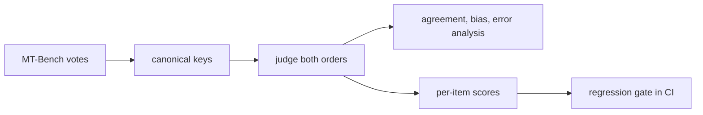
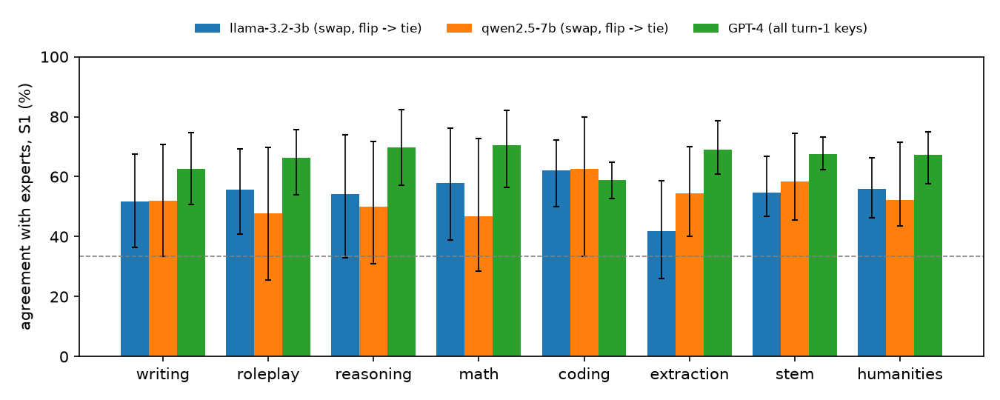

<h1 align="center">LLM Evaluation Harness</h1>

<p align="center">
  <a href="https://github.com/haroonkhan02/llm-eval-harness/actions/workflows/ci.yml"></a>
  <a href="https://github.com/haroonkhan02/llm-eval-harness/actions/workflows/eval-gate.yml"></a>
  
  
</p>

A small library and CLI for evaluating LLM systems, with a focus on the judge itself:
how often does an LLM-as-judge agree with human experts, how biased is it, where does it
go wrong, and when is a drop in quality between two runs real rather than noise.

## What it does

- Loads the 3,355 expert votes and 2,400 GPT-4 votes of the MT-Bench human judgments and
  measures judge vs. human agreement, Cohen's kappa and 95 % intervals from a bootstrap
  over questions (votes on one question are correlated).
- Runs pairwise judges (Anthropic, or open-weight models locally with MLX) on both answer
  orders, logging tokens, cost and latency to a resumable JSONL store.
- Measures position and length bias, and breaks disagreements down by category, expert
  consensus and how close the two models are.
- Gates regressions: a paired sign test and bootstrap on per-item scores, run by a
  GitHub Action that fails a pull request when the candidate is worse than the baseline.



## Results

**Sanity check.** Recomputing Table 5 of the MT-Bench paper (Zheng et al., 2023) from the
released votes lands within 1.4 points on all eight cells, e.g. turn 1 GPT-4 vs. human
66.6 % [62.8, 70.5] with ties (paper 66 %) and 85.9 % without (paper 85 %). My pair
counts are higher than the paper's (1,689 vs. 1,343 on turn 1), reason unknown.
Details: [reports/gpt4_human_agreement.md](reports/gpt4_human_agreement.md).

**Local judges.** Two 4-bit models judged the same 200 turn-1 pairs in both orders.
Agreement is with the expert votes, ties included (S1).

| Judge | First answer wins / second | Flips on swap | One order | Swap, flip → tie | Swap, abstain on flip (coverage) |
|---|---|---|---|---|---|
| Llama-3.2-3B-Instruct | 60.4 / 36.8 % | 43.6 % | 51.4–56.7 % | 52.0 % | 69.4 % (56 %) |
| Qwen2.5-7B-Instruct | 57.8 / 37.8 % | 32.0 % | 56.5–57.1 % | 52.6 % | 66.8 % (68 %) |
| Released GPT-4 votes | – | 16.0 % | – | 68.1 % | 70.3 / 74.0 % on the same subsets |

Both local judges favour the answer shown first and flip two to three times as often as
GPT-4. Abstaining on flips brings them level with GPT-4 on the pairs they answer, but
those are the easier pairs and they skip a third or more. There is no sign of length bias
beyond what the experts themselves show. Intervals are about ±7 points, so the 3B vs. 7B
differences are not significant. [reports/judge_bias_common_keys.md](reports/judge_bias_common_keys.md)

**Where judges disagree with experts** (S1, % agreement; local judges with flip → tie):

| Slice | Llama-3.2-3B | Qwen2.5-7B | GPT-4, same keys | GPT-4, all keys |
|---|---|---|---|---|
| Experts unanimous (2+ votes) | 62 | 60 | 86 | 82 |
| Experts split | 44 | 37 | 50 | 46 |
| Close model pair (strength gap < 0.15) | 47 | 34 | 59 | 56 |
| Distant pair (gap > 0.30) | 62 | 66 | 78 | 77 |
| Maths questions | 58 | 47 | 78 | 66 |

When experts disagree among themselves, every judge drops to 37–50 %, so part of the
"error" is label noise. The local judges lose most against GPT-4 on keys the experts
agree on, on close pairs and on maths and reasoning. I read the 12 order-consistent Qwen
verdicts that contradict unanimous experts: 8 were expert ties, which the judge almost
never gives, and several reward a longer explanation over a correct answer, because the
prompt has no reference solution. Per-category tables and confusion matrices:
[reports/error_analysis.md](reports/error_analysis.md).



**Regression gate.** Per-item score = share of expert votes a judge matches on that key.
Rule: fail when the mean drops by more than 2 points and a one-sided sign test gives
p < 0.05.

| Baseline → candidate | Items | Delta [90 % CI] | Gate |
|---|---|---|---|
| Qwen2.5-7B, answer order swapped | 200 | +2.5 [−2.0, +6.7] | pass |
| Llama-3.2-3B, answer order swapped | 394 | −4.3 [−8.3, −0.5] | fail |
| Qwen2.5-7B → Llama-3.2-3B, swap + flip → tie | 197 | −1.8 [−7.1, +2.9] | pass |
| GPT-4 → Qwen2.5-7B, swap + flip → tie | 200 | −11.5 [−17.7, −5.8] | fail |

The gate catches the big drop from GPT-4 to a local judge. It also fails Llama when only
the answer order changes: with a position-biased judge, a nuisance change looks like a
real regression, which is a good argument for swapping before gating. In a simulation on
the GPT-4 scores (27 % of items re-scored at random per run, as measured between answer
orders; the drop itself is injected), the rule fails 2–4 % of unchanged candidates and
catches a 5-point drop 55 % of the time at 200 items and 99 % at 800. Proving a candidate
is no more than 2 points worse (non-inferiority) is much harder: that rule fails 40–84 %
of unchanged candidates at 100–800 items.
[reports/regression_gate.md](reports/regression_gate.md)

## Repository structure

```text
llm-eval-harness/
├── configs/mtbench.yaml        # dataset revision, bootstrap settings, judge model
├── src/llmeval/
│   ├── download.py             # llmeval-download: MT-Bench parquet at a pinned revision
│   ├── mtbench.py              # canonical vote loader, llmeval-stats
│   ├── metrics.py              # agreement, kappa, cluster bootstrap
│   ├── agreement.py            # llmeval-agreement: GPT-4 vs. human sanity check
│   ├── judge.py                # prompt, [[A]]/[[B]]/[[C]] parser, swap-and-aggregate
│   ├── backends.py             # Fake, Anthropic and MLX backends with cost and latency
│   ├── store.py                # resumable JSONL run store
│   ├── run_judge.py            # llmeval-judge: judge pairs in both orders
│   ├── bias.py                 # llmeval-bias: agreement, position and length bias
│   ├── errors.py               # llmeval-errors: disagreement by category, consensus, gap
│   ├── gate.py                 # llmeval-gate / llmeval-scores: paired regression gate
│   └── gate_study.py           # llmeval-gate-study: gate on real runs + power simulation
├── evals/                      # baseline and candidate scores checked by the gate workflow
├── reports/                    # generated tables and figures; judgments/ = verdict CSVs
├── .github/workflows/          # ci.yml (lint + tests), eval-gate.yml (blocks regressions)
└── tests/                      # synthetic votes and a mocked Anthropic client
```

## Getting started

```bash
uv venv --python 3.12 && source .venv/bin/activate
uv pip install -e ".[dev,anthropic,mlx,plots]"
llmeval-download        # ~1.4 MB of parquet into data/mtbench
llmeval-agreement       # reports/gpt4_human_agreement.md
llmeval-judge --backend mlx:mlx-community/Qwen2.5-7B-Instruct-4bit \
              --name qwen2.5-7b --n-keys 200      # about 10 s per pair on an M5
llmeval-bias llama-3.2-3b qwen2.5-7b --common-keys --out reports/judge_bias_common_keys
llmeval-errors llama-3.2-3b qwen2.5-7b
llmeval-gate-study
pytest -q
```

To gate your own change, write per-item scores (`id,group,score`) for the accepted and
the proposed run to `evals/baseline.csv` and `evals/candidate.csv` and open a pull
request; locally, `llmeval-gate evals/baseline.csv evals/candidate.csv` exits 1 on a
regression. The Claude judge requires an Anthropic API key (`ANTHROPIC_API_KEY`); tests
mock it.

## Design decisions

| Decision | Why |
|---|---|
| Canonical keys (sorted model pair) | The two vote splits list pairs in different orders; raw labels can't be compared. |
| Bootstrap over questions, not votes | Votes on one question are correlated; per-vote intervals would be too narrow. |
| Judge every pair in both orders | Position bias is the largest judge error here and can only be seen by swapping. |
| Sign test + tolerance for the gate | Few false alarms on noisy runs; non-inferiority needs far more items than a typical eval set. |
| Verdict CSVs committed, model text not | Reports can be rebuilt without the models; full outputs stay in `runs/` locally. |

## Limitations and future work

- Two small local judges and 200–400 keys; the Claude judge is built and tested with a
  mocked client but has not been run. Larger samples are needed to separate judges.
- The judge prompt has no reference answer; MT-Bench uses reference-guided grading for
  maths and reasoning, and that is where my judges fail most. Next step.
- Expert labels are noisy (split votes), which caps any judge's agreement.
- The power numbers come from a simple churn model, not from repeated real runs.

## License

MIT. The MT-Bench human judgments are released by LMSYS under CC-BY-4.0.
